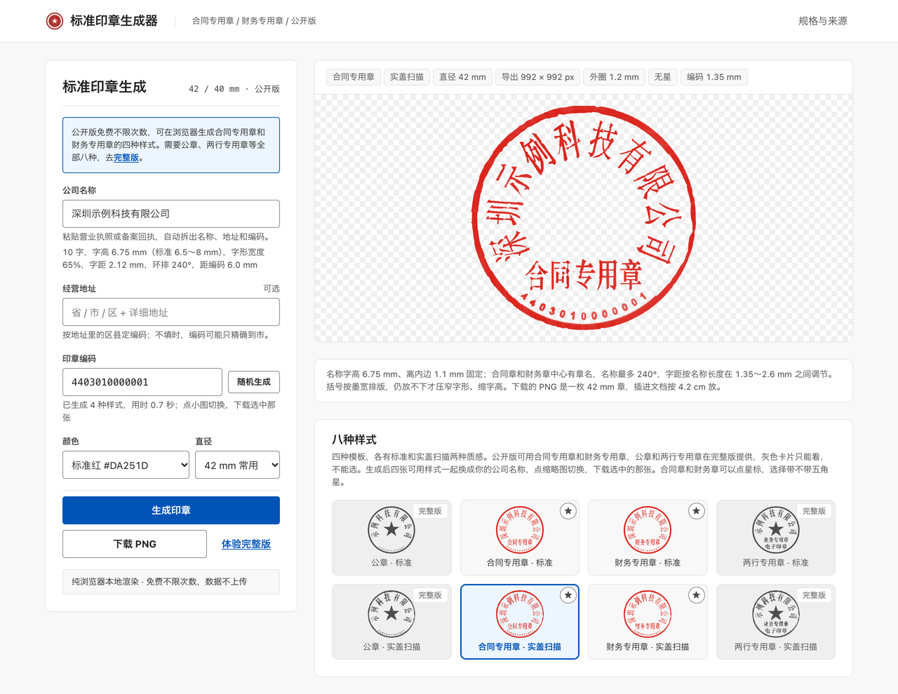

<p align="center">
  
</p>

# 标准印章生成器（公开版）

> 纯前端零依赖开源版本：直接在浏览器本地生成合同专用章与财务专用章，导出 600 dpi 透明 PNG。


[快速开始][quick] · [功能][features] · [与完整版差别][diff]

> [!WARNING]
> **合规与法律声明**：本工具仅用于排版研究、内部测试与设计参考，生成的印章图像**不具备任何法律效力**，亦非经公安机关备案的实体印章或符合《中华人民共和国电子签名法》的合法电子印章。依据《中华人民共和国刑法》第二百八十条、《印章治安管理办法》等相关法律法规，严禁使用本工具伪造、变造国家机关、公司、企业、事业单位或人民团体印章，严禁用于任何未经授权的签署、冒用、欺诈等违法违规行为。使用者须自行核验并确保拥有相关名称及内容的合法使用权，一切法律责任由使用者自行承担。正式对外文件请使用依法备案的实体印章或合规电子签章平台。



## 快速开始

- **直接打开即用**：下载本仓库后双击打开 `index.html`，或托管到 GitHub Pages / Cloudflare Pages 等任意静态空间。
- **本地预览服务**：

```bash
python3 -m http.server 8000
```

打开 <http://127.0.0.1:8000/>。

## 功能

- **4 种可用样式**：支持合同专用章与财务专用章的「标准」「实盖扫描」共 4 种（可切换带星标），页面同时展示完整版其余样式卡片作预览指引。
- **出图与单张下载**：点「生成印章」在本地绘制 4 张结果，切换大图预览后单张下载选中的 600 dpi 透明 PNG，拖入 WPS 按 `4.2 cm`（42 mm）或 `4.0 cm`（40 mm）放到文字上层即可。
- **零网络传输**：区划识别与图像绘制全在浏览器本地完成，名称与编码不上传；版式依据见页面底部「规格与来源」。

## 与完整版差别

| 项目 | 公开版（本仓库） | 完整版（线上部署） |
| --- | --- | --- |
| 可用样式 | 合同、财务专用章共 4 种 | 公章、合同、财务、两行专用章共 8 种 |
| 部署方式 | 纯前端静态页，无需服务器 | 独立服务端渲染 |
| 入口 | 本地打开或自行静态托管 | <https://hey-yx.com/ohmystamp/1/> |

本仓库代码保留所有权利，未另附开源许可证。

[quick]: #快速开始
[features]: #功能
[diff]: #与完整版差别
